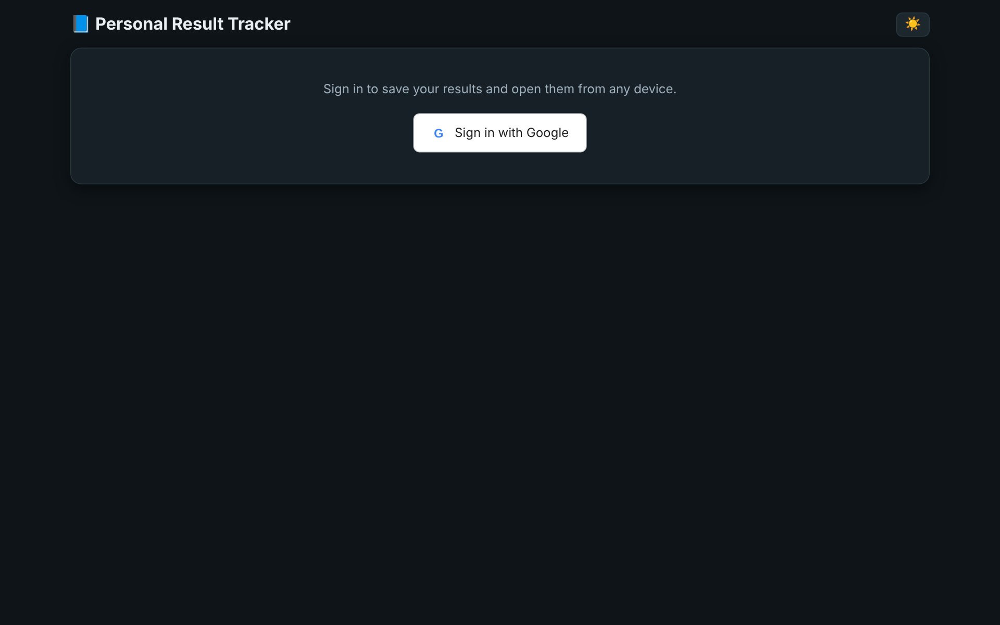
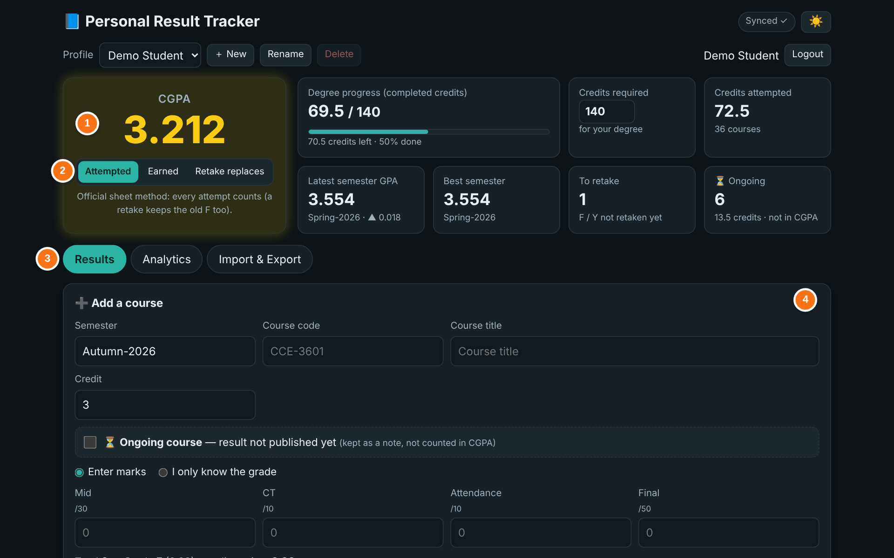
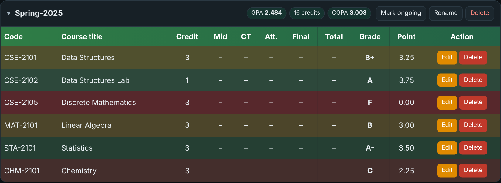
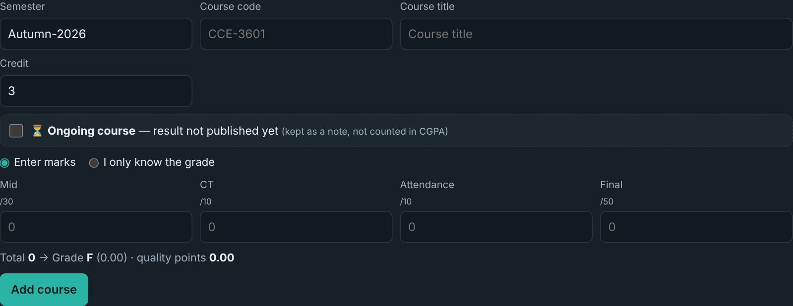
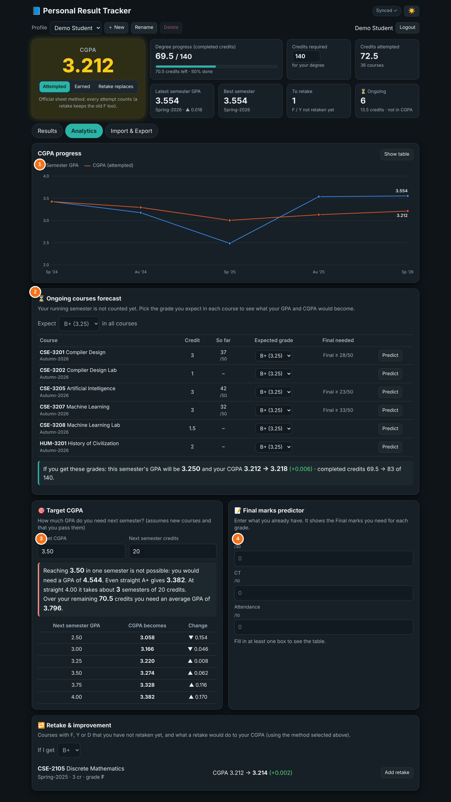
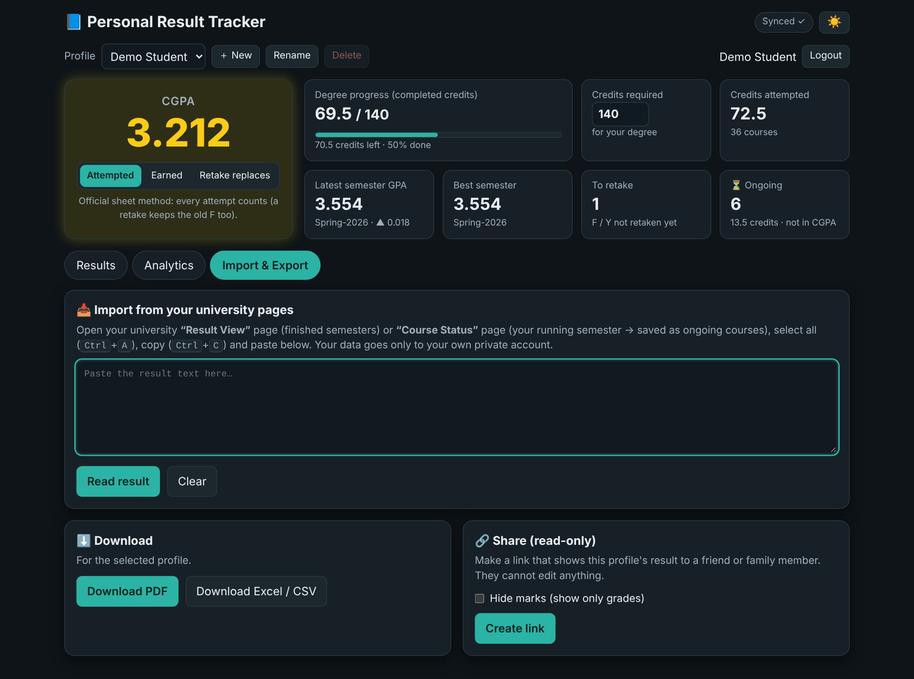
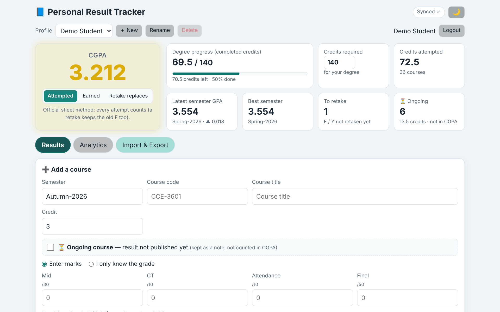
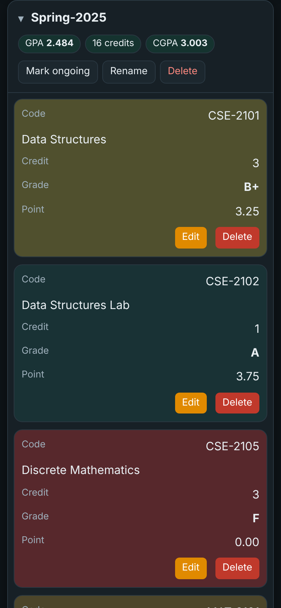

<div align="center">

# 📘 Personal Result Tracker

**Track your semester results and CGPA, and open them on any device.**
Sign in with Google, import your university result sheet in one paste, and see exactly what grades you need next.

[🚀 **Live app**](https://abdurrahmancce.github.io/personal-result-tracker/) · [🐞 Report a bug](https://github.com/abdurrahmancce/personal-result-tracker/issues)


</div>

> 🔒 The screenshots below use **demo data**, not a real student's results.

---

## 📸 Screenshots

### 🔑 1. Sign in
Log in with your Google account. Your results are saved to your own private space and follow you to every device.



### 📊 2. Dashboard
Everything important at a glance.



| # | What it shows |
|---|---------------|
| **1** | 🎯 **Your CGPA**, updated live as you add courses. |
| **2** | 🔀 **CGPA method**: *Attempted*, *Earned* or *Retake replaces* (see [CGPA methods](#-cgpa-methods)). |
| **3** | 🗂️ **Tabs**: *Results*, *Analytics*, *Import & Export*. |
| **4** | ➕ **Add a course** form (marks or just a grade, or mark it as ongoing). |

The cards also show degree progress, credits attempted, latest and best semester GPA, courses to retake, and ongoing courses.

### 📚 3. Results, semester by semester
Each semester is a card with its own GPA and running CGPA. Colours show how each course went, and you can edit, delete, rename a semester, or use **Mark ongoing** on it.



### ➕ 4. Add a course
Enter Mid / CT / Attendance / Final and the grade is worked out for you, or type the grade directly. Tick **Ongoing course** if the result isn't published yet.



### 📈 5. Analytics


| # | Tool | What it does |
|---|------|--------------|
| **1** | 📉 **CGPA progress** | Line chart of semester GPA and CGPA over time (with a table view). |
| **2** | ⏳ **Ongoing courses forecast** | Pick the grade you expect in each running course and see your new GPA and CGPA. Shows the **final marks needed** based on marks so far. |
| **3** | 🎯 **Target CGPA** | Tells you the GPA you need next semester to reach your goal, or says honestly when it isn't possible. |
| **4** | 📝 **Final marks predictor** | Enter Mid, CT and Attendance to see the Final marks needed for each grade. |

There is also a **Retake & improvement** section showing what retaking an F, D or Y course would do to your CGPA.

### 📥 6. Import & Export


- 📋 **Import**: open your university *Result View* or *Course Status* page, select all, copy, paste, and press **Read result**. You get a preview before anything is saved.
- 📄 **Download** your results as **PDF** or **Excel / CSV**.
- 🔗 **Share (read-only)**: create a link for a friend or family member. They can't edit, you can hide marks, and ongoing courses are never shared. You can stop sharing any time.

### 🌗 7. Light & dark mode
Switch with the ☀️ / 🌙 button. Your choice is remembered.



### 📱 8. Works great on phones
On small screens, tables turn into easy-to-read cards.

<p align="center"></p>

---

## ✨ Features

| | Feature |
|---|---|
| 🔐 | **Google sign-in**, so your data is private and synced across devices |
| ☁️ | **Cloud sync** with Firebase Firestore, plus **offline support** (changes sync when you're back online) |
| 🗓️ | **Semester-wise results** with credits and weighted GPA / CGPA |
| 🔀 | **Three CGPA methods** (attempted, earned, retake replaces) |
| ⏳ | **Ongoing courses** kept as notes and **not counted** until the final result is entered |
| 🔮 | **Forecast**, **target CGPA**, **final marks predictor** and **retake planner** |
| 📈 | **CGPA graph** and per-semester stats |
| 🔍 | **Search and sort** courses |
| 📥 | **One-paste import** from the university result pages |
| 📄 | **PDF and Excel/CSV export** |
| 🔗 | **Read-only share link** |
| 👤 | **Multiple profiles** (for example yourself and a sibling) |
| 🌗 | **Dark / light mode** |
| 📱 | **Installable app (PWA)** with mobile card view |

---

## 🧮 CGPA methods

| Method | How it is calculated | When to use |
|--------|----------------------|-------------|
| **Attempted** | All grade points ÷ all attempted credits (every attempt counts, a retake keeps the old F too) | Matches the official university sheet |
| **Earned** | Grade points ÷ credits of **passed** courses only (F and Y are left out) | See your CGPA of passed courses |
| **Retake replaces** | Only the latest attempt of each course is counted | See your CGPA after improvement |

**Grade scale** (total marks → grade → points)

| Marks | ≥80 | ≥75 | ≥70 | ≥65 | ≥60 | ≥55 | ≥50 | ≥45 | ≥40 | <40 |
|-------|-----|-----|-----|-----|-----|-----|-----|-----|-----|-----|
| Grade | A+ | A | A- | B+ | B | B- | C+ | C | D | F |
| Points | 4.00 | 3.75 | 3.50 | 3.25 | 3.00 | 2.75 | 2.50 | 2.25 | 2.00 | 0.00 |

Marks are Mid /30 + CT /10 + Attendance /10 + Final /50 = 100. A **Y** grade (expelled) counts as 0 points.

> ⚠️ The scale and the marks split follow one university's rules (IIUC). If your university differs, adjust `calc.js`.

---

## 📲 Install it as an app

No app store needed. Open the live site and install it:

| Device | Steps |
|--------|-------|
| 🤖 **Android (Chrome)** | Open the site → sign in → tap **Install app** (or menu ⋮ → *Install app*). |
| 🍎 **iPhone / iPad (Safari)** | Open the site in **Safari** → tap **Share** → **Add to Home Screen**. |
| 💻 **Windows / Mac (Chrome or Edge)** | Click the **install icon** at the right of the address bar, or press the in-app **Install app** button. |

Once installed, the app opens in its own window and works offline. Sign in with the same Google account on every device to see the same data.

> ℹ️ On iPhone, an installed app has separate storage, so you may need to sign in once more.

---

## 🛠️ Set up your own copy

You need a free Google account. Each person runs their own Firebase project so the data stays theirs.

### 1️⃣ Create a Firebase project
1. Go to the [Firebase console](https://console.firebase.google.com/) → **Add project**.
2. **Build → Authentication → Sign-in method** → enable **Google**.
3. **Build → Firestore Database** → **Create database**.
4. **Project settings → Your apps → Web (`</>`)** → register an app and copy the config.

### 2️⃣ Add your config
Open `firebase-config.js` and paste your values:

```js
export const firebaseConfig = {
  apiKey: "...",
  authDomain: "your-project.firebaseapp.com",
  projectId: "your-project",
  storageBucket: "your-project.appspot.com",
  messagingSenderId: "...",
  appId: "..."
};
```

### 3️⃣ Publish the security rules
In **Firestore → Rules**, paste the contents of [`firestore.rules`](firestore.rules) and press **Publish**. This makes everyone's data private to them. Share links can be read only by someone who knows the link.

### 4️⃣ Authorise your domain
**Authentication → Settings → Authorised domains** → add the domain where you host the app (for example `yourname.github.io`). `localhost` is already allowed.

### 5️⃣ Run it
Google sign-in needs a web address, so don't open the file by double-click (`file://`).

- **VS Code:** install **Live Server**, right-click `index.html` → *Open with Live Server*, then use `http://localhost:5500`.
- **Or:** `python -m http.server 8000` and open `http://localhost:8000`.

### 6️⃣ Deploy to GitHub Pages
```bash
git add .
git commit -m "Update"
git push
```
Then in the repo: **Settings → Pages → Deploy from branch → `main` / root**. The site goes live in a minute or two.

---

## 🗂️ Project structure

```
📦 personal-result-tracker
 ┣ 📄 index.html            App layout
 ┣ 🎨 style.css             Themes (dark/light) and mobile layout
 ┣ ⚙️ script.js             UI, Firebase auth and sync, tabs, forms
 ┣ 🧮 calc.js               Grades, GPA/CGPA, forecast, predictor
 ┣ 📥 parser.js             Reads pasted university result pages
 ┣ 📈 chart.js              CGPA line chart
 ┣ 📄 exporter.js           PDF and CSV export
 ┣ 🔥 firebase-config.js    Your Firebase settings
 ┣ 🔒 firestore.rules       Database security rules
 ┣ 📲 manifest.webmanifest  App name, icons, install info
 ┣ 📴 sw.js                 Service worker (offline support)
 ┣ 🖼️ icon-*.png            App icons
 ┗ 📁 docs/screenshots      Images used in this README
```

**How your data is stored** 🗄️

```
users/{your-id}/profiles/{profile}            ← profile name, required credits
users/{your-id}/profiles/{profile}/courses/*  ← your courses
shares/{share-id}                             ← read-only snapshot (only if you create a link)
```

---

## 🔐 Privacy

- Your results live in **your own** Firebase account area and can only be read by you.
- A **share link** is a snapshot that anyone with the link can open. Turn it off with **Stop sharing**.
- The app has no ads and no tracking of its own.

---

## 🧰 Built with

- Vanilla **HTML, CSS and JavaScript** (ES modules, no build step)
- **Firebase Authentication** and **Cloud Firestore**
- **jsPDF** and **jsPDF-AutoTable** for PDF export
- A **service worker** and **web app manifest** for the installable app

---

## 🤝 Contributing

Ideas and fixes are welcome! Open an [issue](https://github.com/abdurrahmancce/personal-result-tracker/issues) or send a pull request.

## 👤 Author

**Abdur Rahman**, [@abdurrahmancce](https://github.com/abdurrahmancce)

⭐ If this helped you, give the repo a star!
